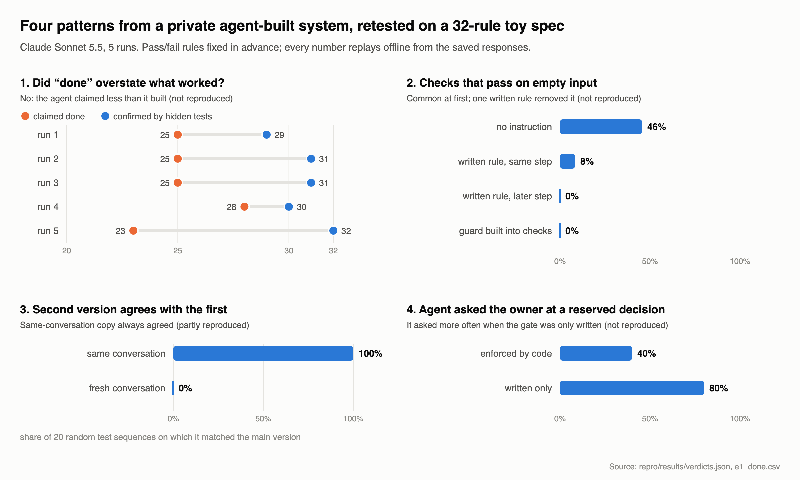

# A clean-room reproduction harness

This folder tests four claims about checking code written by AI agents, on a small invented
problem ("Depot", a stock-and-cash ledger with 32 numbered rules called *clauses*). The whole
specification is in `BRIEF.md`. The claims, in short:

- **E1**: an agent's "done" and its passing checks overstate what really works;
- **E2**: checks written by agents pass when given nothing to check;
- **E3**: a second version written by the same agent shares the first one's mistakes;
- **E4**: agents stop at owner decisions more often when code enforces the stop.

The pass/fail rules for each claim were fixed in advance in
`repro/results/PREREGISTRATION.md`. Choices made while building are in `DECISIONS.md`.

The write-up that explains where these claims came from and what the results mean is
[`writeup.md`](writeup.md).

## Results of the first live recording (5 runs of `claude-sonnet-5-5`, $5.02)



| Claim | Verdict | In one line |
|---|---|---|
| E1: "done" overstates what works | does not reproduce | the agent claimed 23–28 of 32 rules done; the hidden tests confirmed 29–32 |
| E1: pass rate vs mutation score | does not reproduce | every agent test suite passed 100%, so pass rate predicts nothing |
| E1: mutation score misses absent rules | reproduces (2 cases) | modules missing a whole rule still scored 79% and 85% |
| E1c: claimed fixes vs real fixes | descriptive | 13 claimed, 2 landed; all 11 misses are one arguably unclear rule |
| E2: checks pass on nothing | does not reproduce | 46% did at first; one written rule brought later checks to 0% |
| E3: same-agent version shares mistakes | partial | same-conversation version agreed with the implementation every time; independent one never did |
| E4: code-enforced stops beat written ones | does not reproduce | the agent asked about written-only decisions 80% of the time, code-enforced ones 40% |

Full numbers, caveats and the original-vs-corrected table after the audit are in
`repro/results/summary.md`.

## A second model: `claude-haiku-5-5` (5 runs, $0.62)

Recorded separately under amendments A11 and A12, with the same prompts, seeds, hidden tests and
verdict rules. Its first attempt failed the validity bar fixed in advance (53% of calls were cut off
at the output limit) and is kept as a failed run. The re-run with four times the output limits
passed it (3 of 68 calls cut off, 0 refused). With five runs per model the comparison is
descriptive, not a test.

| Claim | Sonnet | Haiku |
|---|---|---|
| E1: "done" overstates what works | does not reproduce (median gap −6) | **partial** (median gap +4: claimed 26–30 rules done, 24–30 passed) |
| E1: mutation score misses absent rules | reproduces (2 modules) | reproduces (11 modules, median score 73%) |
| E1c: claimed fixes vs real fixes | 13 claimed, 2 landed | 15 claimed, 0 landed |
| E2: checks pass on nothing | 46% at first, 0% later with the rule | 72% at first, 2% later with the rule |
| E3: same-conversation version agrees | always | always |
| E4: asked about written vs code-enforced decisions | 80% vs 40% | 70% vs 20% |

Haiku's over-claims were on supplier rules, where its module demanded a warehouse that the
spec's call signatures do not take (partly a loose point in the spec), and on lot expiry and
shipping order. Its own tests passed on every rule in every run. Full
numbers: `repro/results_by_model/anthropic_haiku_x4/summary.md`.

## Current status

**The main live recording** (2026-11-04): 74 calls to `claude-sonnet-5-5`, five seeds, $5.02 spent
under a $12 cap approved by the owner. The responses are saved in `repro/recordings/`, so
`make repro` recomputes every table from them offline. An independent audit then fixed two scoring
bugs (amendments A6–A8 in `repro/results/PREREGISTRATION.md`); A9 makes one verdict label follow the
pre-registered wording, and A10 renames a product in one hidden test. None of them is a new recording. `repro/results/summary.md` shows the
original and the corrected numbers side by side. The hand-written test answers (marked `SYNTHETIC`)
are still used by the plumbing tests only.

## Running it offline (no model, no network)

```bash
python3 -m venv .venv && .venv/bin/pip install pytest
make repro            # same as: cd repro && .venv/bin/python -m repro run --offline
make test             # the harness's own tests
.venv/bin/python -m repro estimate   # what a live run would cost; calls nothing
```

`run --offline` replays saved model answers ("recordings") and recomputes every table and
`repro/results/summary.md`. It blocks all network access and never falls back to calling a model:
a missing recording is an error. If `repro/recordings/` holds no live recordings, it uses the
hand-written plumbing set instead, and every row is marked `SYNTHETIC`.

## How a live run would work (needs the owner's approval)

A live run calls a real model and costs money, so it needs the owner's approval of a budget.

1. Install the official SDK: `.venv/bin/pip install anthropic`.
2. **The live run uses the Anthropic API key from the environment** (`ANTHROPIC_API_KEY`), read by
   the SDK. Model and prices are in `repro/providers/prices.toml`.
3. Run `.venv/bin/python -m repro run --live --budget-usd 5`. It prints the cost estimate and asks
   for confirmation before the first call.
4. Before every call it works out the worst-case cost of that call. If that would take total
   spending past the budget, it stops cleanly and marks the results `INCOMPLETE`. A budget above
   $5 is refused unless `--owner-approved-budget` is also given.
5. Each answer is saved in `repro/recordings/` with the provider, model, time, request
   fingerprint, token counts, cost and `origin: live`. Afterwards `make repro` recomputes everything
   from those recordings without calling anything.

Note: the current estimate for one provider and five seeds is above $5 (see `DECISIONS.md`), so a
$5 run will probably stop part way.

## Add your model

The harness can run any model behind an OpenAI-compatible endpoint, and one run of five seeds
costs about $5 at mid-range prices (`.venv/bin/python -m repro estimate --provider my_model` gives
the figure for your prices before anything is called).

1. In `repro/providers/prices.toml`, copy the `[openai_compat]` section to a new section named
   after your model, for example `[my_model]`. Fill it in (model id, prices per million tokens,
   `base_url`, and the name of the environment variable that holds your key), then set
   `placeholder = false` and `enabled = true`.
2. Run `.venv/bin/python -m repro run --live --provider my_model --budget-usd 5`. It shows the
   estimate and asks before the first call, and it never spends past the cap. (Above $5 it also
   needs `--owner-approved-budget`.)
3. Your responses go to `repro/recordings/my_model/` and your tables to
   `repro/results_by_model/my_model/`; the main results are not touched, and
   `python -m repro run --offline --provider my_model` replays yours. Open a pull request with the
   two folders and the new `prices.toml` section.

The verdict rules in `repro/results/PREREGISTRATION.md` apply unchanged, so results are comparable
across models.

## Where things are

| Path | What it is |
|---|---|
| `repro/spec/` | the toy spec and data table given to the agent |
| `repro/oracle/` | the harness author's own correct version and the hidden tests (never shown to the agent) |
| `repro/agent/` | the fixed agent pipeline and its versioned prompts |
| `repro/providers/` | model providers: replay, recording, Anthropic, an optional second one |
| `repro/checks/` | presence, reach, mutation testing, the empty-input guard, differential testing |
| `repro/experiments/` | the four experiments |
| `repro/results/` | pre-registration, CSV tables, `summary.md` |
| `repro/tests/` | the harness's own tests, and the hand-written plumbing answers |
| `repro/recordings/` | the 74 saved live model responses, each with its origin and cost; second-model recordings in subfolders |
| `repro/results_by_model/` | result tables for other models, one folder each (including the failed first Haiku run) |
| `writeup.md` | the 2–4 page write-up |
| `figures/` | the summary figure and the script that draws it from the result files (`make figure`) |
| `CITATION.cff` | how to cite this work |
| `LICENSE` | MIT licence (code and everything except the write-up) |
| `LICENSE-writeup.md` | CC BY 4.0 licence for `writeup.md` |

Agent-written code is only ever run in a separate process, in a temporary folder, with a time limit
and no network.

## Licence

The write-up (`writeup.md`) is licensed under CC BY 4.0 (see `LICENSE-writeup.md`).
Everything else, including the code, is under the MIT licence (see `LICENSE`).
