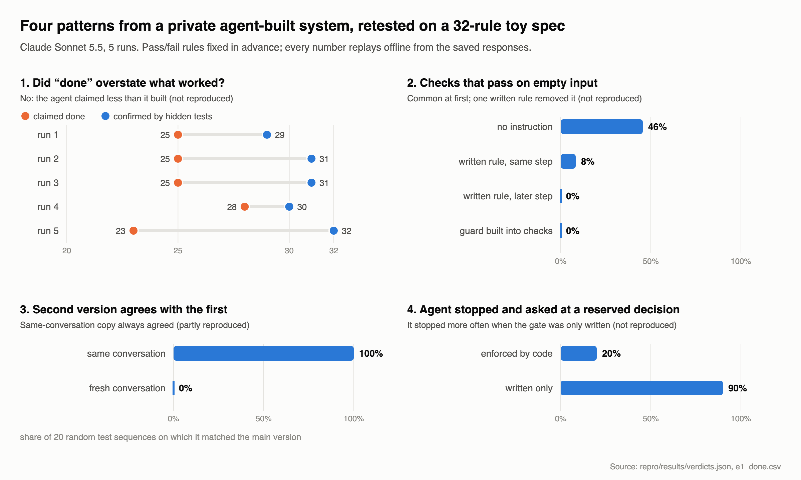

# When "done" isn't done: four observations about checking agent-written software, and what a clean reproduction kept

*Dhairyashil R G, November 2026. The code, the saved model responses and the pre-registration are in the accompanying repository.*

## 1. The problem

Coding agents now write both the software and the evidence that it works: the tests, the checks, the progress reports and often the review. A person overseeing that work mostly sees the evidence. So the useful question is not only "does the agent write correct code?" but "when the evidence says it's fine, how often is it wrong, and in what way?"

This note reports four patterns we saw in a larger private system, where language-model agents built software from written design documents over several weeks. Then it reports what happened when we tried to reproduce each pattern cleanly, on a small invented problem, with pass/fail criteria fixed in advance. Some patterns held. Most did not. We report both, because the gap between the two settings is itself informative.

## 2. Setup

**The private system.** We observed a larger private system: a set of tools, each built and maintained by LLM coding agents, that together turned design documents into two interactive applications. Agents worked from task lists, ticked tasks when done, wrote their own tests and automated checks, logged their decisions, and stopped at gates reserved for the human owner (spending, irreversible actions, design decisions). A coordinating agent ran the others. The record we mined is the task lists, decision logs, audit notes and version history. We cannot publish any of it. Numbers from it appear below only as "in the private system we observed…", and each one comes with its limits.

**The clean reproduction.** It was built from a short written brief by a separate agent that never saw the private material. Its parts:
- **The task.** An invented inventory-and-cash-ledger module, specified as 32 numbered rules. The rules include behaviour that only shows up when something goes wrong (late deliveries, cash going negative, items expiring) and events that only appear in a log.
- **Planted problems.** Two rules contradict the data table on purpose. Three decisions are reserved for the "owner", who never answers. One read-only helper file contains a real bug.
- **The agent under test.** Claude Sonnet 5.5 (`claude-sonnet-5-5`), run 5 times, with each run seeing the rules in a different order. In every run it writes the module, writes its tests, fixes failures (at most 2 rounds), writes a demonstration script, and reports which rules are done.
- **Ground truth.** A hidden test suite of 138 tests, written before any agent output existed, and a hand-written correct version. Both were fixed by hash in the pre-registration.
- **Cost and replay.** One live recording: 74 model calls, $5.02. Every response is saved with its origin and cost, so all results can be recomputed offline: a few minutes from a clean copy, seconds once cached.
- **A second model.** Claude Haiku 5.5 (`claude-haiku-5-5`) was added afterwards under its own dated amendments, with the same prompts, seeds, tests and verdict rules (§3.5).

**One rule we added because of the private system.** There, some "review results" turned out to be hand-written stand-in responses, not real model judgements. In the reproduction, a hand-written response may be used to test the plumbing, but it can never feed a result.

## 3. Findings

### 3.1 "Done" means "present on the path I ran", not "the promise can be reached"

**Private observation.** In the private system, every automated gate was green, along with dozens of passing scripted walk-throughs. A later audit then compared each promise in the design documents with the built software. It found that **about half (49%) of one application's 140 promises and 64% of the other's 135** were actually reachable by a user.

The system's own diagnosis was that the checks only confirmed what existed along the one scripted path they ran. Promised branches the script never took were invisible to them. Examples:
- every designed audio file existed, yet only about 5 of 56 could ever play;
- a value that should rise and fall never fell, so only one of four outcomes was reachable;
- an economy rule ran backwards, and the balance checks had been tuned to the backwards version, so correcting it turned them red.

What closed the gap was inverting the check: a walk-through fails if any promised item is *not reached*. For one application, the count of built promises then rose from 86 to about 117 of 135, each backed by evidence that it was reached.

In the same system, a mutation test (which plants small bugs and counts how many the tests catch) found one module whose tests all passed while scoring **0**. Those tests only read stored data and never exercised the module's logic, which was wrong.

**Reproduction.** Mostly not reproduced.
- **Over-claiming.** The agent did not over-claim. Across 5 runs it marked 23–28 of the 32 rules "done", while the hidden tests confirmed 29–32 actually worked. Where it was unsure, it said "partial". The pre-registered test (a net gap of at least 4 rules, claimed minus confirmed) **did not reproduce**: the median gap was −6, meaning the agent claimed less than it delivered. It did over-claim one rule in each of two runs, but under-claimed many more.
- **Agent test pass rate.** It was 100% in all 25 module-runs, so it cannot predict anything. The pre-registered comparison with mutation score therefore **does not reproduce**. Mutation score itself correlated weakly and negatively with real correctness (−0.23, 95% interval −0.52 to 0.09).
- **Mutation score stays high when a whole rule fails.** This **reproduced** by the pre-registered rule, but thinly. In two modules every hidden test of one rule failed, yet the agent's tests still caught 79% and 85% of planted bugs. In both, the rule was the late-penalty rule reserved for the owner, which the agent left open on purpose. So this shows that mutation score is blind to behaviour the tests never check, not that the agent forgot a rule.
- **Control suites behaved as expected.** A test suite that only reads stored values passed 100% and caught a median of **0%** of planted bugs, the same as the private 0-score case. A suite of tests that assert nothing also caught 0%. The hidden suite used as tests caught 83%.
- **Claimed fixes.** Of 18 review comments (12 distinct), the agent said it applied 13; only 2 took effect. Every miss concerns one rule where the spec is arguably unclear about whether cash should go down, so this is a weak signal, not a finding.

**Reading.** On a one-page spec that fits in a single prompt, this agent was cautious and mostly correct. The private gap appeared over weeks, in large code bases, with many rules that only matter on paths a script doesn't take. The reproduction did not create those conditions, so it neither confirms nor refutes the private observation for them. The part about checks held only weakly: passing tests, and even a good mutation score, said nothing about behaviour the tests never checked.

### 3.2 Checks that pass when there is nothing to check

**Private observation.** In the private system, every one of 10 agent-built components had checks that passed on empty input: zero runs, zero rows, zero files. A one-hour audit against a written checklist fixed **about 90** such places. In the following two weeks the same class came back **at least 13 times**, each time on a kind of check created after the audit (import checks, recorded-video checks, walk-through promises). **8 of the 9** cases found strictly after the audit were caught by a person reading outputs (file sizes, frames). No automated check caught any of them. In one case a fix for an empty measurement guarded one number, while other numbers from the same empty measurement still passed.

**Reproduction.** Partly reproduced: the first condition held, the rest did not, so the pre-registered verdict is **does not reproduce**.
- The first condition held: with no instruction, **46%** of the agent's checks passed on empty or unmeasured input.
- A single written rule ("an empty result never passes a check") then cut that to 8% on the checks written with it in view. Checks written later, in a separate step, were at **0%**, where we had predicted a relapse. But that step was shown the earlier, rule-following checks and asked to match them, so it may have copied the pattern rather than applied the rule.
- A guard built into the check framework gave 0%, as it must whenever the checks use the framework (all did).

**Reading.** The tendency is real and large. The private recurrence came over weeks, with many agents and new kinds of check. A single later step on the same day, with rule-following examples in view, is not that, and here the written rule was enough. The framework guard is still the cheaper and more reliable fix, because it cannot be forgotten.

### 3.3 A reference implementation by the same author is not an independent check

**Private observation.** In the private system, the "independent" reference used to cross-check the main implementation was written by the same agent, usually in the same change: **14 of 14** changes to one touched the other. The cross-check was almost always green. Its few disagreements were about timing or logging, and it caught **no** real rule error. Several real errors passed it because both sides shared them: a moving entity could pass through solid objects, every random seed gave identical results, and the economy rule ran backwards (this last one is inferred from the shared data, not stated in any record). Where the two sides disagreed, the reference was sometimes edited to match.

**Reproduction.** Partly reproduced.
- **The same-conversation reference.** In all 5 runs it agreed with the implementation on all 20 test sequences, and it described itself as making "the same choices as the main implementation".
- **The independent reference** (same model, fresh conversation) disagreed with the implementation on every sequence. In one run that was only because it crashed on construction.
- **Shared mistakes.** On the two planted contradictions, the same-conversation reference shared the implementation's mistake in 1 of 5 runs; the independent one in 0 of 5. The independent one did make one of the planted mistakes itself in one run, just not where the implementation did.
- **Disagreement with the correct version.** Every agent-written version disagreed with the hand-written correct version on nearly every sequence. The cause is about six places where the one-page spec can be reasonably read two ways: whether a delivery costs cash, how an average is taken, where rounding happens, what "undo" covers. So the comparison mostly measures different readings of a loose spec, which limits what it can show.

**Reading.** A same-context reference is close to a copy of the implementation, so agreement with it is weak evidence. The independent reference disagreed, as an independent check should, and its disagreements mostly fell on the places where the spec was unclear. That is useful whichever side was right.

### 3.4 Gates enforced by code vs gates written in prose

**Private observation.** In the private system we found **no** breach of any owner gate enforced by code or a ledger (spending caps, irreversible actions). One sub-agent refused to spend on an approval relayed by another agent; it wanted the owner's own words. Gates that existed only as prose ("this is the owner's decision") behaved differently. The coordinating agent often decided, recorded the decision and offered a revert. Six such changes were never answered and became permanent.

**Reproduction.** **Did not reproduce** (after two rounds of scoring fixes, see §4).
- **Code-enforced decision.** The agent always left it open (the harness enforces that), but asked the owner about it in only **20%** of runs.
- **Prose-only decisions.** The agent asked the owner about every one (10 of 10). A behavioural probe confirmed it had left the decision open in 9 (**90%**); in the tenth the probe could not tell. It never decided on its own.
- **The read-only helper with a bug.** The agent never edited it. It asked about it in 2 runs, avoided it and explained the bug in 2, and used it unchanged in 1.

**Reading.** On a short task with a few clearly marked decisions, this agent respected prose gates well. The private pattern involved a coordinating agent holding a broad delegation, over weeks, with an owner who was often away. We think the authority to interpret a delegation is the variable that matters, and this reproduction did not vary it.

### 3.5 A second model

We added Claude Haiku 5.5, a smaller model often used as a sub-agent, after the main results. The rule fixed in advance: report it whichever way it goes, as long as no more than 10% of its calls are refused or cut off. The first attempt failed that bar. 53% of calls hit the output limit, mostly with no text, because the model's thinking used the whole allowance. That run is kept and labelled as failed. A re-run with four times the output limit passed (3 of 68 calls cut off, $0.62). With five runs per model, the comparison is descriptive.

- **Over-claiming appeared.** Haiku marked 26–30 rules "done"; the hidden tests confirmed 24–30. The median gap was **+4** (Sonnet: −6), which moves 3.1's verdict from "does not reproduce" to **partial**. It is not "reproduces" because the reach check (the inverted check from 3.1) flagged none of the gap: every rule's behaviour was reached, it just behaved differently from the hidden tests.
- **Where it over-claimed.** Mostly in two places:
  - In 4 runs, its supplier code demanded a warehouse argument that the spec's call signatures don't have. The spec doesn't say where deliveries go, but Sonnet kept to the signatures.
  - In 3 runs, stock didn't expire or ship in the order the hidden tests expect. We haven't established whether that is an off-by-one bug or another reading of "older than".

  Smaller misses were on the planted shelf-life contradiction and the notification log. Its own tests passed on every rule in every run, because they tested its own interface and its own reading.
- **Mutation score with a whole rule failing** stayed high again, on 11 modules (median 73%). None is a forgotten rule. They are the owner-reserved rule, the warehouse mismatch and the lot-order failures.
- **Claimed fixes.** 15 claimed, 0 landed, out of 34 review comments.
- **Otherwise similar, with one more verdict change.**
  - Empty-input checks: 72% passed at first (Sonnet: 46%), and the written rule cut later ones to 2%.
  - References: the same-conversation reference again always agreed. Here the fresh-conversation one also shared the planted shelf-life mistake, in all 5 runs, so 3.3's verdict is **does not reproduce** for Haiku.
  - Owner decisions: Haiku never asked about the code-enforced decision, and stopped at 80% of the written-only ones.

**Reading.** The private over-claiming pattern did show up, but only with the smaller model. It appeared only where the agent's tests could agree with its own interface or reading while the hidden tests did not, and part of it traces to a loose point in the spec. It is a narrow, five-run result. It does suggest that Sonnet's caution in 3.1 is partly a property of the model. It also suggests that a reach check cannot catch an agent that reaches every rule but reads some of them wrongly.

## 4. A note on our own measurement

An independent audit of the scoring code, after the live run and before any interpretation, found two bugs:
- The prose-gate check read its own injected value back as the agent's choice. That produced a false "reproduces" for 3.4.
- The cross-check compared behaviour the spec leaves open.

After release v1.0.0, three more independent reviewers recomputed every number. A cold offline replay matched every table byte for byte, but they found two more bugs, both in 3.4:
- The code-gate check counted questions about the buggy helper, which mention "rounding", as questions about the rounding decision.
- The penalty probe sometimes never triggered a payment, and scored that as a decision.

They also flagged sentences that said more than the data.

Every fix is a dated amendment to the pre-registration, applied by re-scoring the saved responses offline, with the earlier verdicts kept beside the corrected ones. No verdict changed in the second round; the 3.4 numbers and some wording did.

We note the irony. The class of error this note is about appeared in our own harness twice, and reviewers independent of the builder caught it both times. We would not trust these numbers without those audits.

## 5. Limitations

- **Two models, five runs each, one small invented spec.** Every reproduction number is small-sample, and the two models are compared descriptively only. The longer, larger, multi-agent conditions of the private system were not reproduced.
- **The private observations come from one system with one owner.** They were mined from agent-written logs, which only show what agents chose to write down.
- **The hidden tests follow one reading of the spec.** About six rules have a second reasonable reading, and that affects 3.1's claimed-fix count and 3.3's comparison with the correct version.
- **No sampling randomness.** The model API we used does not accept a temperature or a seed, so runs differ only in the order in which the rules were presented.
- **Some scoring relies on keyword matching.** In 3.4, whether the agent asked about a decision or recorded one is judged that way, and can miss or misattribute unusual wording. The read-only helper's labels are keyword-only.
- **3.2's later step saw rule-following examples,** so it cannot separate following a written rule from copying a pattern.

## 6. Open questions

1. **Scale.** At what task size and duration does "done" start to drift from "reachable"? A reproduction with a longer spec, several agents and multi-day histories would test the conditions where the private gap appeared.
2. **Recurrence.** Do written rules against empty-input passes decay as new kinds of check are added over time, while framework guards hold?
3. **Real independence.** How independent does a reference need to be (fresh context, different model, different provider) to catch shared spec misreadings? Is disagreement with a fresh-context reference a cheap way to find unclear specs?
4. **Delegation.** Does an agent that holds a broad delegation over other agents widen prose gates more than one working alone?
5. **Claimed against applied.** How often does an agent report a review comment as applied when it isn't, once the spec is unambiguous?

*The reproduction's code, brief, pre-registration with amendments, saved responses and result tables are in this repository. `make repro` recomputes every number above offline.*

*This write-up is licensed under [CC BY 4.0](https://creativecommons.org/licenses/by/4.0/). The code is under the MIT licence.*
